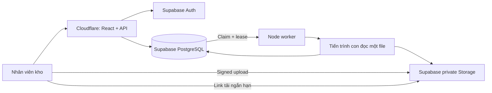

# Kiến trúc v2

Mục tiêu: giữ UI ComsFlow, giảm phạm vi ảnh hưởng khi đọc PDF lớn, lưu dữ liệu độc lập với vòng đời máy chủ web và phục hồi tác vụ sau lỗi.

Web và worker dùng pooler, `prepare=false`, connection pool nhỏ. RLS bật trên dữ liệu; browser không truy vấn trực tiếp bảng nghiệp vụ. Chỉ API/worker giữ DATABASE_URL và service-role key; frontend chỉ nhận public key cùng token tải file đúng đường dẫn. Tài khoản được cấp bởi admin, khóa/role được kiểm tra ở database mỗi request và khi chạy job.

## Nhập file

1. Browser tính SHA-256, gửi metadata nhỏ, nhận đường upload ký riêng theo user/job.
2. File đi trực tiếp vào private Storage; API xác minh metadata kích thước trước khi enqueue.
3. Worker kiểm tra lại kích thước/hash, quyền đang hiệu lực, rồi gọi parser/nghiệp vụ kế thừa trong child process.
4. Xem trước không tự lưu đơn. Người dùng xác nhận; cùng job chuyển sang bước commit với file/context/mapping bất biến. Đơn hoàn dùng fingerprint của preview để phát hiện dữ liệu thay đổi.
5. Business writes và kết quả job nằm trong cùng transaction. Nếu child chết hoặc lưu kết quả lỗi, cả giao dịch rollback. Retry không thực hiện lại job đã commit.

Queue claim dùng `FOR UPDATE SKIP LOCKED`, token fencing, lease 10 phút, child timeout 8 phút, tối đa 3 lần tự thử cho lỗi tạm thời. Job đang thực thi giữ row lock; worker khác bỏ qua khi claim. Không tin role hoặc đường dẫn file do browser cung cấp để thực thi.

Worker chạy một file một lúc; child V8 heap 384 MB, nhưng RSS bao gồm buffer/native nên **không coi 384 MB là toàn bộ RAM**. Khởi đầu worker riêng khoảng 1–2 GB, đo peak RSS với file thật và tăng tài nguyên khi cần. Một file hỏng có thể làm child thất bại; mục tiêu là không kéo sập API quét đơn.

## Quét và xuất dữ liệu

Giữ transaction, request UUID idempotency và unique success per shipment. Không hiển thị thành công nếu chưa nhận được phản hồi xác nhận. Quét xuất kho, xác nhận bàn giao nội bộ và trạng thái tiếp nhận của hãng vẫn là ba bằng chứng khác nhau.

CSV lịch sử quét chạy nền, đọc cursor theo batch 500, có cả JSON request/response, thời gian UTC đến microsecond và giờ Việt Nam. Snapshot repeatable-read và kiểm tra số dòng bảo đảm không bị hụt vì phân trang. Báo cáo được lưu bền ở Storage kèm row count, bytes, SHA-256; URL tải ký 5 phút, có thể tạo lại. Báo cáo nghiệp vụ khác giữ giới hạn lọc sẵn có (một số báo cáo tối đa 50.000 dòng); lịch sử quét theo ngày không có giới hạn 50.000 này.

## Mở rộng và backup

- Scale web/API độc lập với parser. Tăng replica Node worker khi queue dài, mỗi replica chỉ claim job riêng. Theo dõi connection pool và contention trước khi tăng đồng loạt.
- Dashboard tổng hợp bằng SQL trong PostgreSQL, không kéo toàn bộ scan payload về API để tính lại theo từng giờ. Index theo thời gian/kho/kết quả scan. Khi dữ liệu hàng chục triệu dòng, đo query plan rồi thiết kế partition theo tháng; chưa tự partition hoặc thay đổi khóa ngoại trong bản này.
- PostgreSQL: bật backup/PITR phù hợp gói, kiểm tra quyền restore và diễn tập khôi phục. Storage cần phương án backup object riêng; backup database không đồng nghĩa backup file.
- Xóa bản ghi tạo khoảng trống để PostgreSQL tái sử dụng; không bảo đảm hóa đơn/dung lượng vật lý giảm ngay. Có thể lưu trữ dữ liệu cũ ra kho riêng trước khi xóa đã xác nhận.
- Theo dõi API 5xx/latency, Postgres RAM/disk/connections, tuổi job chờ lâu nhất, số job lỗi, heartbeat worker và restore drill. UI cảnh báo worker mất liên lạc; không tự báo web hỏng chỉ vì worker đang bận.

KOC HUB được tham chiếu theo mô hình hosting Cloudflare và Supabase do người dùng cung cấp. URL public không cung cấp mã nguồn/database; chưa xác minh hoặc sao chép logic nội bộ KOC HUB.
